 

## 🧰 Skills

  

## 👾 Arcade

Pac-Man is eating my contribution graph

<picture>
  <source media="(prefers-color-scheme: dark)" srcset="https://raw.githubusercontent.com/kaushik00101/kaushik00101/output/pacman-contribution-graph-dark.svg">
  <source media="(prefers-color-scheme: light)" srcset="https://raw.githubusercontent.com/kaushik00101/kaushik00101/output/pacman-contribution-graph.svg">
  
</picture>

Thanks for visiting. Have a good day ☁️ &nbsp;·&nbsp; またね (*mata ne*), see you soon

