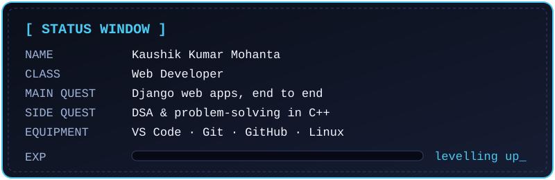
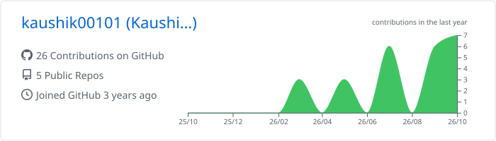
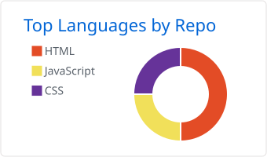
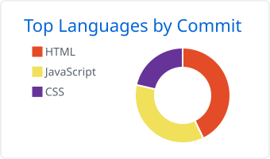
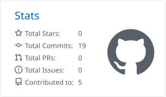

 

## ⚔️ Prologue

  

 

- 🏯 Building web applications with **HTML, CSS, JavaScript, Python, Django and MySQL**.
- ⚔️ Sharpening problem-solving with **C++, data structures and algorithms**.

## 🧰 Skills

<picture>
  <source media="(prefers-color-scheme: dark)" srcset="https://skillicons.dev/icons?i=html,css,js,python,django,mysql,cpp,git,github,vscode,linux&theme=dark">
  <source media="(prefers-color-scheme: light)" srcset="https://skillicons.dev/icons?i=html,css,js,python,django,mysql,cpp,git,github,vscode,linux&theme=light">
  
</picture>

| Category | Skills |
| :-- | :-- |
| 🎨 **Frontend** | HTML · CSS · JavaScript |
| ⚙️ **Backend** | Python · Django |
| 🗄️ **Data** | MySQL |
| 🧠 **Core** | C++ · Data structures & algorithms |
| 🧰 **Gear** | Git · GitHub · VS Code · Linux |

## 📊 Battle stats

<picture>
  <source media="(prefers-color-scheme: dark)" srcset="./profile-summary-card-output/github_dark/0-profile-details.svg">
  <source media="(prefers-color-scheme: light)" srcset="./profile-summary-card-output/github/0-profile-details.svg">
  
</picture>

<picture>
  <source media="(prefers-color-scheme: dark)" srcset="./profile-summary-card-output/github_dark/1-repos-per-language.svg">
  <source media="(prefers-color-scheme: light)" srcset="./profile-summary-card-output/github/1-repos-per-language.svg">
  
</picture>
<picture>
  <source media="(prefers-color-scheme: dark)" srcset="./profile-summary-card-output/github_dark/2-most-commit-language.svg">
  <source media="(prefers-color-scheme: light)" srcset="./profile-summary-card-output/github/2-most-commit-language.svg">
  
</picture>

<picture>
  <source media="(prefers-color-scheme: dark)" srcset="./profile-summary-card-output/github_dark/3-stats.svg">
  <source media="(prefers-color-scheme: light)" srcset="./profile-summary-card-output/github/3-stats.svg">
  
</picture>

## 👾 Arcade

Pac-Man is eating my contribution graph

<picture>
  <source media="(prefers-color-scheme: dark)" srcset="https://raw.githubusercontent.com/kaushik00101/kaushik00101/output/pacman-contribution-graph-dark.svg">
  <source media="(prefers-color-scheme: light)" srcset="https://raw.githubusercontent.com/kaushik00101/kaushik00101/output/pacman-contribution-graph.svg">
  
</picture>

...and the snake is hungry too

<picture>
  <source media="(prefers-color-scheme: dark)" srcset="https://raw.githubusercontent.com/kaushik00101/kaushik00101/snake-output/github-snake-dark.svg">
  <source media="(prefers-color-scheme: light)" srcset="https://raw.githubusercontent.com/kaushik00101/kaushik00101/snake-output/github-snake.svg">
  
</picture>

## ⚡ Recent activity

<!--START_SECTION:activity-->
1. Activity will appear here after the first workflow run.
<!--END_SECTION:activity-->

<!--
Optional "now watching" block. Fill it in and delete the comment tags.

## 📺 Currently watching
- Title one
- Title two
-->

Thanks for visiting. Have a good day ☁️ &nbsp;·&nbsp; またね (*mata ne*), see you soon

